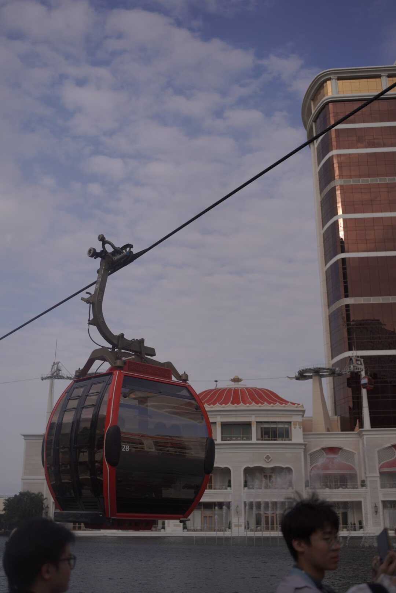
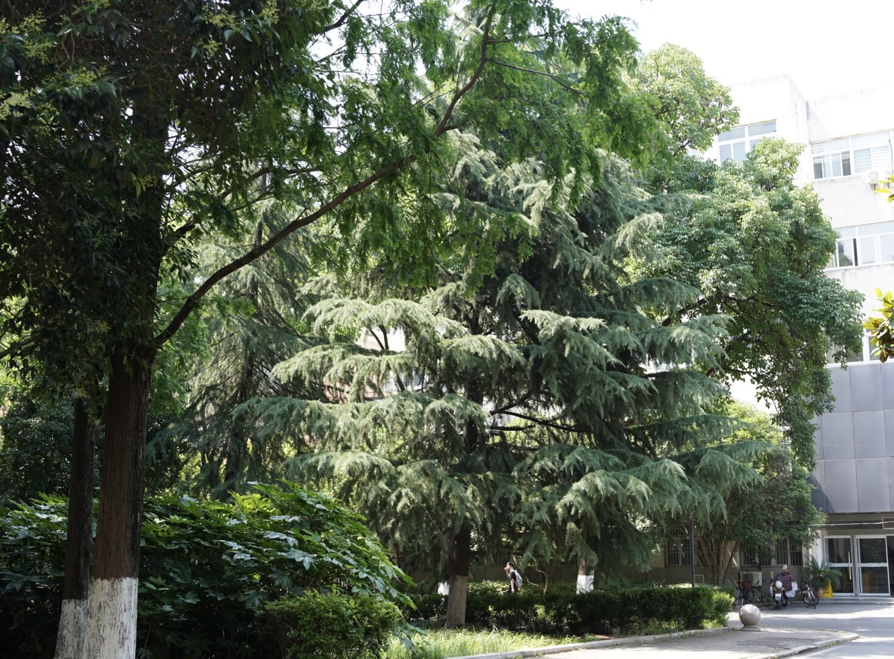

<section id="hero" class="hero-section">
  

    
  

  

    <h1 class="hero-name">
      {{ site.title }}{{ site.chinese_name }}
    </h1>
    

      

        I am currently an undergraduate student in the YSL Class at Hefei University of Technology (HFUT) (Sep. 2023 – Jul. 2027),
        where I work as a Research Assistant advised by
        <a href="https://faculty.hfut.edu.cn/~Azauye/zh_CN/index.htm" target="_blank" rel="noopener">Prof. Qiang Zhang</a>
        and Prof. Yanjiu Zhong, and collaborate remotely with
        <a href="https://wangxuhongcn.github.io/" target="_blank" rel="noopener">Dr. Xuhong Wang</a>
        at the Shanghai Artificial Intelligence Laboratory.
      

      

        Starting from July 2026, I have also been a Research Assistant at the PEAK Lab, The Hong Kong University of Science and Technology (Guangzhou),
        supervised by <a href="https://changhao-chen.github.io/" target="_blank" rel="noopener">Dr. Changhao Chen</a>.
      

    

    

      
      <a class="social-pill" href="{{ site.google_scholar }}" target="_blank" rel="noopener">
        <i class="ai ai-google-scholar"></i> Google Scholar
      </a>
      
      
      <a class="social-pill" href="{{ site.orcid }}" target="_blank" rel="noopener">
        <i class="fa-brands fa-orcid"></i> ORCID
      </a>
      
      
      <a class="social-pill" href="{{ site.github_link }}" target="_blank" rel="noopener">
        <i class="fa-brands fa-github"></i> GitHub
      </a>
      
      
      <a class="social-pill" href="mailto:{{ site.email }}">
        <i class="fa-regular fa-envelope"></i> Email
      </a>
      
      
      <a class="social-pill" href="{{ site.cv_link }}" target="_blank" rel="noopener">
        <i class="ai ai-cv"></i> CV (PDF)
      </a>
      
    

  

</section>

<section id="about" class="section">
  <h2 class="section-title"><i class="fa-regular fa-user section-icon"></i> About Me</h2>
  

    My research focuses on <strong>world models</strong> for <strong>generalist, self-improving agents</strong>. Broadly, I am interested in how an agent can learn what matters from what comes after: whether acting in the physical world or updating itself, what an action means becomes clear only through what follows it.
  

  

    More recently, I have been focusing on two threads:
  

  <ul class="about-threads">
    <li>
      <strong>Action Representation &amp; Generation:</strong> Developing robust visual representations and lightweight manipulation policies for reliable, cross-embodiment robotic control.
    </li>
    <li>
      <strong>Recursive Self-Improvement (RSI):</strong> Making better use of accumulated experience across learning rounds, and building standardized testbeds, toolkits, and datasets to enable foresight-driven self-modification.
    </li>
  </ul>
  

    

      🤝
      Feel free to reach out via <a href="mailto:{{ site.email }}">Email</a> if you are interested in collaborating on my research!
    

    

      🔎
      I am actively looking for <strong>MPhil / Ph.D.</strong> or <strong>Research Assistant (RA)</strong> opportunities.
    

  

</section>

<section id="news" class="section">
  <h2 class="section-title"><i class="fa-regular fa-newspaper section-icon"></i> News</h2>
  

    

      Oct. 2026
      Our Chinese invention patent (first inventor) was <strong>granted</strong>!
    

    

      Jul. 2026
      Joined the <strong>PEAK Lab</strong> at HKUST(GZ) as a Research Assistant.
    

    

      Jun. 2026
      Our paper <strong>DRIFT</strong> was published in <em>Expert Systems with Applications</em>.
    

    

      Nov. 2025
      Received <strong>First Prize</strong> in the 19th “Challenge Cup” National College Students’ Extracurricular Academic Science and Technology Works Competition.
    

    

      Jun. 2025
      Selected for the <strong>2025 Excellence Program</strong> of the National College Student Innovation and Entrepreneurship Training Program.
    

  

</section>



<section id="projects" class="section">
  <h2 class="section-title"><i class="fa-solid fa-gears section-icon"></i> Selected Projects</h2>
  

    <article class="info-card">
      

        <h3 class="info-card-title">Continual Growth Mechanisms for Space Embodied-Intelligence Robots</h3>
        Sep. 2025 – Sep. 2026
      

      
Core Member · CASC Fifth Academy Project

      

        Contributed to continually adaptive lunar-construction robots by developing an Isaac Sim–MuJoCo simulation platform, multimodal task and failure data pipelines, and algorithms for coordinated updates to robot structure, control policies, and task knowledge.
      

    </article>

    <article class="info-card">
      

        <h3 class="info-card-title">Heterogeneous Multi-Robot Decision System</h3>
        May 2025 – May 2026
      

      
Team Lead · Invention Patent Granted (1st Inventor) &amp; Software Copyright Filed

      

        Led a heterogeneous multi-robot decision pipeline in which an LLM interpreted multimodal observations and assigned tasks by robot capability, followed by path planning, execution, and closed-loop feedback.
      

    </article>
  

</section>

<section id="honors" class="section">
  <h2 class="section-title"><i class="fa-solid fa-award section-icon"></i> Honors &amp; Awards</h2>
  <ul class="honors-list">
    <li><strong>First Prize</strong>, 19th “Challenge Cup” National College Students’ Extracurricular Academic Science and Technology Works Competition, 2025.</li>
    <li><strong>2025 Excellence Program</strong>, National College Student Innovation and Entrepreneurship Training Program.</li>
  </ul>
</section>

<section id="skills" class="section">
  <h2 class="section-title"><i class="fa-solid fa-wrench section-icon"></i> Technical Skills</h2>
  

    

      Research Areas
      

        Diffusion Policies
        Vision-Language-Action Models
        World-Action Models
        Recursive Self-Improvement
        Representation Learning
      

    

    

      Programming &amp; ML
      

        Python
        C/C++
        Bash
        PyTorch
      

    

    

      Robotics &amp; Tools
      

        ROS 2
        MuJoCo
        Isaac Sim
        Gazebo
        Unitree SDK
        Linux
        Git
        LaTeX
      

    

  

</section>

<section id="life" class="section">
  <h2 class="section-title"><i class="fa-solid fa-camera-retro section-icon"></i> Life</h2>
  

    

      

        Outside of research, I enjoy taking life slow—noticing good architecture, roadside flowers, and passing scenery. I am also learning photography, listening to J-POP, and enjoying a good beer.
      

      

        <i class="fa-regular fa-hand-pointer"></i> Hover the photo stack to fan out · Click to view full photo
      

    

    

      

        <button type="button" class="stack-card" data-src="./assets/img/photos/photo-1.png" aria-label="View photo 1">
          
        </button>
        <button type="button" class="stack-card" data-src="./assets/img/photos/photo-2.png" aria-label="View photo 2">
          
        </button>
        <button type="button" class="stack-card" data-src="./assets/img/photos/photo-3.png" aria-label="View photo 3">
          
        </button>
        <button type="button" class="stack-card" data-src="./assets/img/photos/photo-4.png" aria-label="View photo 4">
          
        </button>
        <button type="button" class="stack-card" data-src="./assets/img/photos/photo-5.png" aria-label="View photo 5">
          
        </button>
        <button type="button" class="stack-card" data-src="./assets/img/photos/photo-6.png" aria-label="View photo 6">
          
        </button>
      

    

  

</section>
